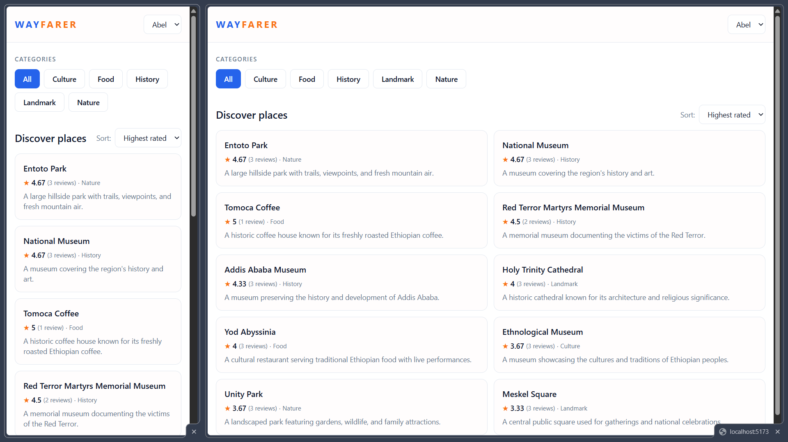
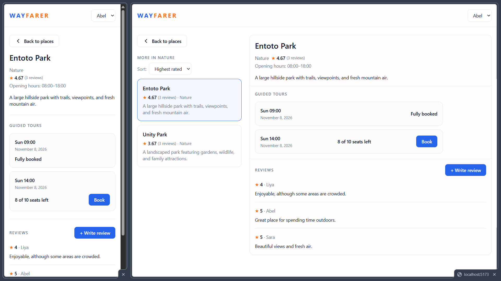
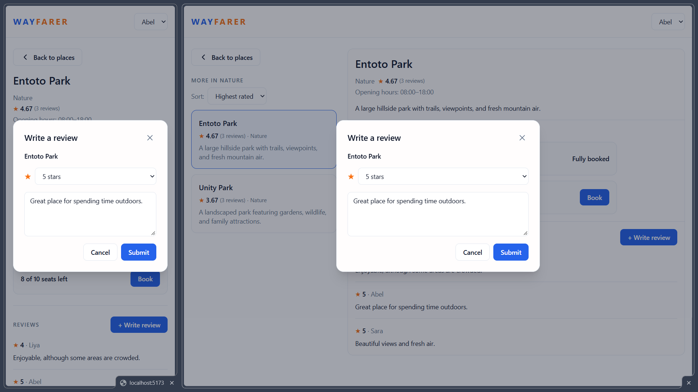
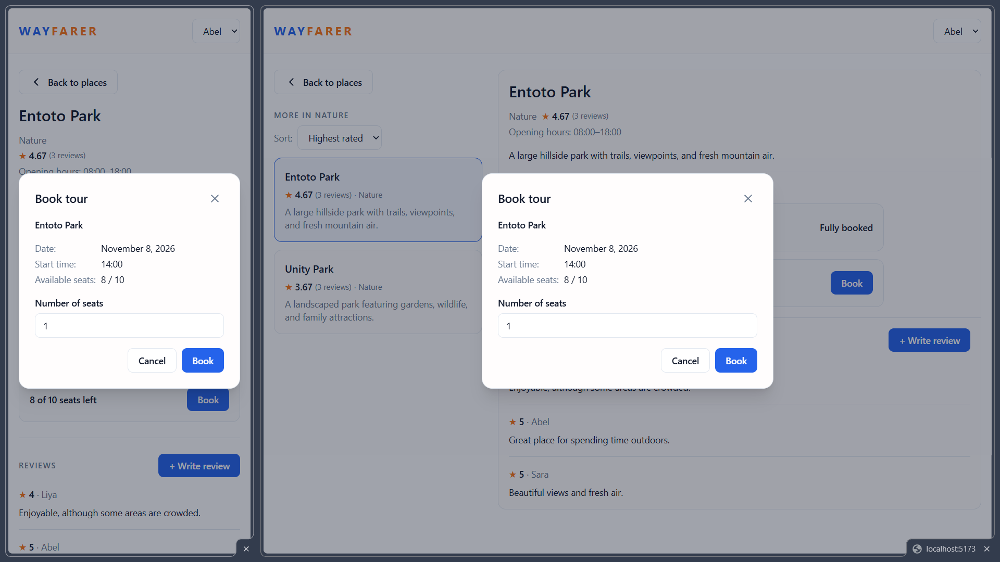

# Wayfarer

Wayfarer is a full-stack web application that helps travellers browse places within a selected city, view place details, explore guided tours, read reviews, and reserve seats.

The application uses a seeded user system rather than authentication. Users can switch between predefined accounts through an acting-as selector in the frontend.

The backend is responsible for business rules, rating calculations, booking availability, and data consistency.

The application focuses on two important problems:

- **Unreliable ratings:** Ranking places using only average ratings can produce misleading results when places have significantly different numbers of reviews.
- **Tour overbooking:** Concurrent booking requests must not result in reservations exceeding a tour's available capacity.

## Table of Contents

- [1. Getting Started](#1-getting-started)
- [2. Screenshots](#2-screenshots)
- [3. Features](#3-features)
- [4. Technology Stack](#4-technology-stack)
- [5. Project Structure](#5-project-structure)
- [6. Architecture](#6-architecture)
- [7. Database and Seed Data](#7-database-and-seed-data)
- [8. Running Tests](#8-running-tests)
- [9. API Overview](#9-api-overview)
- [10. Known Limitations](#10-known-limitations)
- [11. Documentation](#11-documentation)

## 1. Getting Started

### Prerequisites

- Node.js >= 24.21.0
- pnpm >= 12.16.1
- PostgreSQL >= 18.6

### 1. Clone the repository

```bash
git clone https://github.com/SaleamlakH/wayfarer-sale-habtamu.git
cd wayfarer-sale-habtamu
```

### 2. Install dependencies

```bash
pnpm install
```

### 3. Configure environment variables

Each application has its own example environment file. Copy both and configure the required values.

```bash
cp apps/api/.env.example apps/api/.env
cp apps/web/.env.example apps/web/.env
```

### 4. Prepare the database

Create the PostgreSQL database specified in your environment configuration.

Apply database migrations:

```bash
pnpm db:push      # sync the schema without migrations
pnpm db:generate  # generate the client and types
pnpm db:seed      # seed without affecting existing data
```

### 5. Build and start the application

> make sure the web app address is listed in CORS_ORIGINS env variable for the api

```bash
pnpm build        # build apps and their dependency
pnpm dev          # start applications
```

### 6. Run the tests

> The booking integration test requires a PostgreSQL database. It uses `TEST_DATABASE_URL` when set, otherwise `DATABASE_URL`.

```bash
pnpm test
```

## 2. Screenshots

| Screenshot                                                                      | Description                                                                                           |
| ------------------------------------------------------------------------------- | ----------------------------------------------------------------------------------------------------- |
|  | **Place discovery** — Browse places, filter by category, and sort by rating score.                    |
|      | **Place details** — View place information, reviews, tour slots, and same-category places on desktop. |
|             | **Review dialog** — Submit or update a rating and written review.                                     |
|           | **Booking dialog** — Reserve seats while seeing the remaining availability.                           |

## 3. Features

### Places

- Browse available places.
- Filter places by category.
- Sort places by their rating score.
- View detailed information about a place.
- View reviews and guided tour availability.
- View same-category places alongside place details on desktop.

### Reviews

- Submit a rating between 1 and 5 stars.
- Include a short written review.
- Maintain one review per user per place.
- Update an existing review when the same user submits another review for the same place.

### Tour Bookings

- View available tour slots.
- View remaining seats and booking status.
- Reserve multiple seats in a single booking.
- Prevent overbooking under concurrent booking requests.
- Reject bookings when the requested quantity exceeds the available capacity.
- Provide clear feedback when a slot has insufficient capacity or is fully booked.

### User Identification

- Use predefined seeded users.
- Switch the currently acting user through the frontend.
- Identify the current user through the `X-User-Id` request header.

## 4. Technology Stack

| Area            | Technology |
| --------------- | ---------- |
| Language        | TypeScript |
| Frontend        | React      |
| Backend         | Node.js    |
| API Framework   | Express    |
| Database        | PostgreSQL |
| ORM             | Prisma     |
| Package Manager | pnpm       |

## 5. Project Structure

```text
wayfarer/
├── apps/
│   ├── api/
│   │   ├── src/
│   │   │   ├── errors/
│   │   │   ├── db/
│   │   │   ├── services/
│   │   │   ├── controllers/
│   │   │   ├── middleware/
│   │   │   └── routes/
│   │   └── .env.example
│   └── web/
│       ├── src/
│       │   ├── components/
│       │   ├── layouts/
│       │   ├── providers/
│       │   └── pages/
│       └── .env.example
├── packages/
│   └── types/
├── docs/
│   ├── API.md
│   ├── schema.md
│   └── seed.md
├── AI_USAGE.md
├── DECISIONS.md
├── pnpm-workspace.yaml
├── package.json
├── pnpm-lock.yaml
└── README.md
```

The project uses pnpm workspaces to manage the API, web application, and shared types package.

The `docs` directory contains the API reference, database schema, seed data, and screenshots. Project-level reference documents include the technical decisions and AI usage.

### Shared Types

The shared types package contains contracts exchanged between the frontend and backend, including request shapes, response shapes, and API error contracts.

### API

The API contains the application logic, request handling, database operations, and centralized error handling.

### Web

The web application contains the user interface, page composition, reusable components, layouts, and application providers.

## 6. Architecture

The backend follows a layered architecture with dependency injection.

The request-processing flow is:

```text
Routes --> Middlewares --> Controllers --> Services --> Repositories --> Database
```

### Layer Responsibilities

| Layer        | Responsibility                                                                                     |
| ------------ | -------------------------------------------------------------------------------------------------- |
| Routes       | Define API endpoints and connect middleware and controllers.                                       |
| Middlewares  | Retrieve and attach the acting user through the repository, and perform validation when available. |
| Controllers  | Extract request information, invoke services, and return responses.                                |
| Services     | Implement application operations and business rules.                                               |
| Repositories | Handle database queries, persistence, and transaction execution.                                   |
| Errors       | Provide centralized application error handling.                                                    |

Dependencies are constructed and injected through the application composition root. Individual layers do not instantiate their own dependencies.

## 7. Database and Seed Data

The application uses PostgreSQL for persistent storage.

The seed data includes:

- Approximately 10 places.
- Reviews associated with the seeded places.
- Three predefined users.
- Guided tour slots with different capacities and availability.

At least one place has only one or two reviews to demonstrate why average ratings alone are insufficient for reliable ranking.

Database migration and seeding commands are added in the package.json of root and api.

## 8. Running Tests

The API test suite covers the core business rules and runs with Vitest.

Run the full API test suite from the repository root:

```bash
pnpm test
```

The booking integration test uses a real PostgreSQL database. It uses `TEST_DATABASE_URL` when set, otherwise it uses `DATABASE_URL`.

### Implemented Coverage

- **Rating calculation** — one 5.0 review must not outrank 100 reviews averaging 4.7, and a place with more reviews must outrank an equally rated place with fewer reviews.
- **Concurrent booking and capacity** — last-seat races, all-or-nothing rejection, high contention, fully booked slots, and availability fields are verified against PostgreSQL.
- **Review updates** — a second review from the same user updates that user's existing review for the place.

## 9. API Overview

The API provides the following main operations. Request and response contracts, including the shared error envelope, are documented in [docs/API.md](docs/API.md).

| Resource   | Operation               | Description                                                                |
| ---------- | ----------------------- | -------------------------------------------------------------------------- |
| Health     | Check API status        | Returns `Hello` when the API is running.                                   |
| Users      | Fetch users             | Retrieve predefined users for the acting-as selector.                      |
| Categories | List categories         | Retrieve categories for filtering places.                                  |
| Places     | List places             | Retrieve places with category filtering and rating-based sorting.          |
| Places     | Get place details       | Retrieve place information and tour slot availability.                     |
| Bookings   | Create booking          | Reserve a requested quantity of seats in a tour slot.                      |
| Reviews    | Create or update review | Create a review or update the existing review for the same user and place. |
| Reviews    | List reviews            | Retrieve reviews associated with a place.                                  |

Sorting, filtering, availability calculations, and business rules are handled by the backend.

The health endpoint is served at `/health`, outside the `/api` base path.

## 10. Known Limitations

- Authentication is intentionally excluded from the assignment scope.
- User identification relies on a predefined user ID supplied through a request header.
- The application is designed around a selected city.
- Booking functionality focuses on reserving quantities of seats rather than selecting individually numbered seats.
- A user can book the same tour slot multiple times while seats remain available; each request creates a separate booking.
- There is no booking idempotency or retry protection. If a booking succeeds but the response is lost, such as during a network failure, a retry can create another booking until capacity is exhausted.

## 11. Documentation

- [API Reference](docs/API.md) — endpoints, request and response contracts, and the shared error envelope.
- [Technical Decisions](DECISIONS.md) — rating and ranking, and booking concurrency.
- [Database Schema](docs/schema.md) — entities, columns, and constraints.
- [Seed Data](docs/seed.md) — dataset composition and review distribution.
- [AI Usage](AI_USAGE.md) — tools used and the prompts that supported development.
